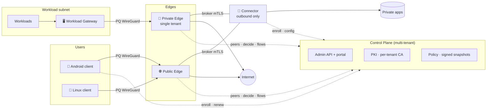

<div align="center">

# OpenSASE

**Open-source, post-quantum SASE platform: zero-trust access, secure egress and policy in one stack.**

[](https://github.com/yuky2020/opensase/actions/workflows/ci.yml)
[](https://yuky2020.github.io/opensase/)
[](LICENSE)


**📖 Documentation: [yuky2020.github.io/opensase](https://yuky2020.github.io/opensase/)**

</div>

---

OpenSASE connects users, sites and workloads to the internet and to private apps through Edges
that enforce one policy per tenant. Every tunnel and every API uses post-quantum hybrid key
exchange. There is no classic fallback.

> [!WARNING]
> **Pre-alpha.** The full path works end to end in the dev stack, and APIs and on-disk formats
> can still change. Do not run it in production yet.

## Highlights

- 🔐 **Post-quantum by default.** TLS 1.3 with `X25519MLKEM768` only, on every listener. WireGuard
  tunnels get a hybrid PQ pre-shared key derived from a TLS exporter ([ADR-0002](docs/adr/0002-client-tunnel-wireguard-pq-psk.md)).
- 🧭 **Zero-trust private access (ZTNA).** Private apps resolve to synthetic addresses and are
  reached through an Edge broker and an outbound-only Connector. Nothing is exposed inbound
  ([ADR-0013](docs/adr/0013-ztna-connector.md)).
- 📱 **Android client.** Flutter UI on a Go core with an on-device firewall. All traffic is
  captured, signed policy snapshots are enforced on the device, and the Edge decides the rest
  ([ADR-0012](docs/adr/0012-android-client-first.md)).
- 🏢 **Private Edge.** The same Edge binary on customer premises, bound to one tenant. It starts
  offline from a signed state cache and keeps a local flow log ([ADR-0014](docs/adr/0014-private-edge.md)).
- 🖥️ **Workload Gateway.** A headless Linux client in gateway mode puts whole subnets (VPCs, server
  LANs) behind the PQ tunnel, with DNS diverted to the Edge and a fail-closed kill switch
  ([ADR-0015](docs/adr/0015-workload-gateway-mvp.md)).
- 🌐 **Web and SaaS control.** The Edge reads the TLS SNI or HTTP Host of every flow, without
  decrypting it, and enforces DNS, SaaS and domain policy on it. Apps cannot be reached by
  address either. A SaaS catalog gives one-click blocking of apps and categories, and shadow-IT
  discovery ([ADR-0017](docs/adr/0017-web-saas-control-sni.md)).
- 🔍 **Opt-in TLS inspection.** A tenant can have the Edge decrypt its HTTPS with a per-tenant
  inspection root, to block URL paths and methods and to set request headers (for example to
  limit a SaaS login to the company's account). Bypass lists, fail-closed behaviour and
  7-day per-Edge intermediates ([ADR-0018](docs/adr/0018-tls-inspection.md)).
- 🛡️ **DLP on uploads.** On the inspected path, request bodies are scanned for card numbers,
  IBANs and Italian tax codes (all checksum-validated), private keys, bulk e-mail and custom
  patterns. The text inside Office documents (old and new), PDF and RTF files, (nested) ZIP
  archives and images (OCR, in an isolated Tesseract service) is read too,
  and rules can cover file downloads. Transfers are blocked or recorded, without ever storing
  the data ([ADR-0019](docs/adr/0019-dlp-request-bodies.md),
  [ADR-0021](docs/adr/0021-dlp-documents-downloads.md)).
- 🗂️ **Web categories.** Block whole categories (adult, gambling, malware, phishing…) from
  the UT1 list of Université Toulouse Capitole, the open list used by most web filters. The
  Control Plane keeps it fresh; Edges enforce it on DNS and on every connection's server name
  ([ADR-0022](docs/adr/0022-web-categories-ut1.md)). SafeSearch can be forced for Google,
  YouTube, Bing and DuckDuckGo ([ADR-0025](docs/adr/0025-safesearch.md)).
- 🦠 **Malware scanning.** Uploads and file downloads on the inspected path are scanned by a
  ClamAV daemon next to the Edge, with fail-open or fail-closed behaviour chosen per tenant
  ([ADR-0020](docs/adr/0020-malware-scanning.md)).
- 🏷️ **Multi-tenant Control Plane.**
  - a per-tenant intermediate CA, and 24h certificates with SPIFFE IDs;
  - signed policy snapshots and flow logs;
  - a super-admin plus tenant-scoped admin tokens ([ADR-0016](docs/adr/0016-tenant-admin-tokens.md));
  - an admin portal (Flutter web, served at `/admin/`).
- 🛡️ **Repeatable security suite.** A dedicated security-tester agent attacks the stack. Every
  attack is saved as a test that runs with `make sectest`.

## Architecture



| Component | What it does | Code |
|---|---|---|
| **Control Plane** | Tenants, users, devices, PKI, policy, decisions, flow logs, admin API and portal | `cmd/controlplane`, `internal/controlplane` |
| **Edge** | PQ WireGuard termination, policy enforcement, DNS filter, NAT breakout, ZTNA broker. Public or private | `cmd/edge`, `internal/edge` |
| **Connector** | Outbound-only link from a private network to the Edge broker | `cmd/connector`, `internal/connector` |
| **Linux client / Workload Gateway** | Headless client; `-gateway CIDRS` forwards whole subnets | `cmd/opensase-client` |
| **Android client** | Flutter app plus Go core (`gomobile`) | `clients/mobile`, `mobile/` |
| **Admin portal** | Flutter web, served by the Control Plane at `/admin/` | `clients/admin` |
| **CLI** | Admin and diagnostics (`opensasectl`, including `pq-check`) | `cmd/opensasectl` |

## What works today

| Area | State |
|---|---|
| PQ tunnel (WireGuard + hybrid PSK) | ✅ |
| Enrollment, 24h certificate renewal, revocation, certificate serial pinning | ✅ |
| Signed policy snapshots, on-device firewall, Edge decisions (`allow` / `deny` / `ask`) | ✅ |
| DNS policy (third-party DNS, DoT and DoH bypass blocked), IPv6 leak protection | ✅ |
| ZTNA through the Connector | ✅ |
| Private Edge: tenant binding, signed offline cache, local flow log | ✅ |
| Workload Gateway (routed subnet, NAT, DNS divert, MSS clamp, kill switch) | ✅ |
| Admin portal (tenants, users, policy, private apps, SaaS apps, web categories, web inspection, infrastructure, admin tokens, audit, activity, security events) | ✅ |
| Tenant-scoped admin tokens: super-admin plus per-tenant admins ([ADR-0016](docs/adr/0016-tenant-admin-tokens.md)) | ✅ |
| Admin audit log: every admin write, with its actor and result, hash-chained and verifiable ([ADR-0028](docs/adr/0028-audit-hash-chain.md)) | ✅ |
| Pinned control URL for enrollment QR codes (`GET /v1/admin/info`), policy ETags against lost updates | ✅ |
| Web and SaaS control without decryption: TLS SNI / HTTP Host enforcement, SaaS catalog, app discovery ([ADR-0017](docs/adr/0017-web-saas-control-sni.md)) | ✅ |
| Opt-in TLS inspection: URL rules (path, method), request header injection, bypass list, HTTP/2 ([ADR-0018](docs/adr/0018-tls-inspection.md), [ADR-0023](docs/adr/0023-http2-inspected-path.md)) | ✅ |
| DLP on uploads: card numbers, IBANs, tax codes, private keys, custom patterns ([ADR-0019](docs/adr/0019-dlp-request-bodies.md)) | ✅ |
| Malware scanning of uploads and file downloads with ClamAV ([ADR-0020](docs/adr/0020-malware-scanning.md)) | ✅ |
| DLP inside Office, PDF and ZIP files, and on file downloads ([ADR-0021](docs/adr/0021-dlp-documents-downloads.md)) | ✅ |
| Web categories from the public UT1 list, enforced on DNS and SNI ([ADR-0022](docs/adr/0022-web-categories-ut1.md)) | ✅ |
| DLP on legacy Office (.doc/.xls/.ppt), RTF and images with OCR ([ADR-0024](docs/adr/0024-dlp-legacy-office-ocr.md)) | ✅ |
| SafeSearch for Google, YouTube, Bing and DuckDuckGo, with bypass protection ([ADR-0025](docs/adr/0025-safesearch.md)) | ✅ |
| DLP on scanned PDFs (OCR) and PDFs with CID fonts ([ADR-0026](docs/adr/0026-pdf-structure-cid-images.md)); brotli and zstd bodies | ✅ |
| Roles inside a tenant: admin, policy-editor, viewer ([ADR-0027](docs/adr/0027-tenant-roles.md)) | ✅ |
| Exact data match, OIDC for the portal, cloud GENEVE ingress for the gateway | 🗺️ planned |

## Quick start (dev stack)

Requirements: Docker with Compose, Go (see `go.mod`), and OpenSSL ≥ 3.5 for the security suite.
To build the mobile client and the portal you also need Flutter, the Android SDK and NDK, and
`gomobile`.

```bash
# 1. PKI, admin token, Control Plane, Edge, a tenant, a user, a policy, a Connector
deploy/dev/bootstrap.sh

# 2. End-to-end checks: tunnel, DNS, policy, ZTNA, Workload Gateway, offline Edge, revocation
make e2e

# 3. Look around
docker compose -f deploy/dev/docker-compose.yml run --rm ctl flows -tenant acme
```

`bootstrap.sh` is idempotent: running it again keeps the PKI and the data and issues a fresh
provisioning key. Secrets stay in `deploy/dev/.env` (mode 0600) and are never printed.

> [!TIP]
> `e2e.sh` revokes the Connector at the end. Run `deploy/dev/bootstrap.sh` again before
> `make sectest`.

<details>
<summary><b>Android client on the emulator</b></summary>

```bash
CONTROL_HOST=10.0.2.2 EDGE_HOST=10.0.2.2 deploy/dev/bootstrap.sh
make apk                                   # Go core .aar + debug APK
adb install clients/mobile/build/app/outputs/flutter-apk/app-debug.apk
```
</details>

<details>
<summary><b>Admin portal</b></summary>

```bash
make portal          # Flutter web build, bundled (no CDN)
# served by the Control Plane at https://<control-host>/admin/
```
</details>

<details>
<summary><b>Tenant admin tokens</b></summary>

```bash
# As the super-admin: give tenant acme its own admin (token written to a 0600 file)
opensasectl admin-token add -tenant acme -name "acme ops" -valid-for 720h -token-out acme.token
OPENSASE_ADMIN_TOKEN=$(cat acme.token) opensasectl whoami     # tenant admin of acme
opensasectl admin-token list -tenant acme
opensasectl audit -tenant acme                                # who changed what
```
</details>

<details>
<summary><b>Private Edge and Workload Gateway</b></summary>

```bash
# Bind an Edge to one tenant, then start it with an offline cache and a local flow log
opensasectl edge add -id site-milan -tenant acme
edge -tenant acme -state-dir /var/lib/opensase-edge -flow-log /var/log/opensase/flows.jsonl ...

# Put a workload subnet behind the tunnel (service user's provisioning key)
opensase-client -gateway 10.30.0.0/24 -enroll -control https://cp.example -key-file key ...
```

The dev stack runs both: the `edge` service keeps its state in `deploy/dev/edge-state`, and the
`gateway` and `workload` services form the `vpc` network (`10.30.0.0/24`).
</details>

## Testing

| Command | What it runs |
|---|---|
| `make test` | Go unit and integration tests with `-race` |
| `make lint` | `golangci-lint` |
| `make app-test` / `make portal-test` | Flutter analyze + tests (mobile app / admin portal) |
| `make e2e` | End-to-end checks against the dev stack |
| `make sectest` | Security suite: black-box scripts plus Go attacks against the dev stack |
| `make sectest-unit` | The Go security checks that need no stack (runs in CI) |

CI runs `go vet`, `go test -race`, `govulncheck`, `golangci-lint`, and the Flutter tests plus an
APK build on every push.

### Security suite

The [security-tester agent](.claude/agents/security-tester.md) attacks the stack the way a hostile
client, a compromised tenant, a stolen device or a network attacker would. Each attack is saved in
[`test/security/`](test/security/README.md) and prints `PASS`, `FAIL`, `KNOWN-FAIL` or `SKIP` with
a stable ID such as `SEC-AUTH-003`. Every `PASS` has a positive control, so a broken test cannot
pass by accident.

```bash
make sectest                                   # full suite
test/security/run.sh 10-tls 70-deploy          # selected areas
SECTEST_DESTRUCTIVE=1 make sectest             # also floods (local docker network only)
SECTEST_SLOW=1 make sectest                    # also waits ~12 min for superseded tunnels to die
```

Coverage areas:
- authentication and role isolation;
- tenant isolation and Private Edge scoping;
- PQ-only TLS, SPIFFE IDs, foreign roots and expired certificates;
- input handling and rate limits;
- data-plane bypasses: DNS, IPv6, metadata, spoofing and ZTNA;
- the offline cache;
- container hardening.

Latest run ([report](docs/security/sectest-2026-11-20.md)): **106 pass · 0 fail · 0 known
failures**. The run found 10 issues, ST-01 to ST-10, and all of them are fixed. The earlier review
is in [`docs/security/review-2026-11-19.md`](docs/security/review-2026-11-19.md).

## Repository layout

```
cmd/            entrypoints: controlplane, edge, connector, opensase-client, opensasectl, ocrd
internal/       private logic: controlplane, edge, connector
pkg/            shared libraries: api, policy, pki, store, firewall, dnsfilter, packet, pqsession, peek, saas, dlp, categories
mobile/         gomobile bridge for the Android client
clients/mobile  Flutter Android app (VpnService + Go core .aar)
clients/admin   Flutter web admin portal
deploy/dev      Docker Compose dev stack, bootstrap.sh, e2e.sh
test/security   repeatable security suite (shell + Go)
docs/           architecture, component specs, ADRs, security reports (the docs site)
mkdocs.yml      docs site config (GitHub Pages)
```

## Documentation

Everything below is also published as a searchable site at
**[yuky2020.github.io/opensase](https://yuky2020.github.io/opensase/)** (built from `docs/` by
`.github/workflows/docs.yml`; preview locally with `make docs-serve`).

- [`CONTEXT.md`](CONTEXT.md): domain glossary. Use these terms in code and docs.
- [`docs/architecture.md`](docs/architecture.md): goals, principles, traffic flows and the technology baseline.
- [`docs/components/`](docs/components): one spec per component (Edge, Control Plane, Connector, Workload Gateway, SWG, CASB, DLP, …).
- [`docs/adr/`](docs/adr/README.md): architecture decisions. Accepted so far: 0002, 0010, 0012, 0013, 0014, 0015, 0016, 0017, 0018, 0019, 0020, 0021, 0022, 0023, 0024, 0025, 0026, 0027 and 0028.
- [`docs/security/`](docs/security): security review and security test reports.
- [`docs/effort-estimate.md`](docs/effort-estimate.md): sizing and phases.

## Roadmap

Planned work and known limitations are tracked as [GitHub issues](https://github.com/yuky2020/opensase/issues). The main lines:

1. **DLP, next slice:** exact data match and fingerprints ([#15](https://github.com/yuky2020/opensase/issues/15)).
2. OIDC sign-in for the portal ([#17](https://github.com/yuky2020/opensase/issues/17)).
3. Policy language decision ([#20](https://github.com/yuky2020/opensase/issues/20), ADR-0005 proposed).
4. Workload Gateway for the cloud: GENEVE ingress, per-workload identity ([#21](https://github.com/yuky2020/opensase/issues/21)).
5. CI for the container images, the e2e and the security suite ([#28](https://github.com/yuky2020/opensase/issues/28)).

## Contributing and security

Contributions are welcome. Read [`CONTRIBUTING.md`](CONTRIBUTING.md) and the
[Code of Conduct](CODE_OF_CONDUCT.md) first. To report a vulnerability, follow
[`SECURITY.md`](SECURITY.md), and do not open a public issue.

## Licence

Copyright 2026 The OpenSASE Authors. Licensed under the [Apache License, Version 2.0](LICENSE); see
also [`NOTICE`](NOTICE). Contributions are accepted under the same licence (inbound = outbound,
Apache-2.0 section 5). No CLA is required.
