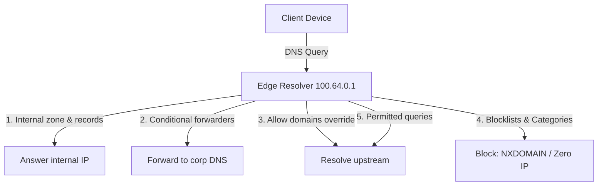

# DNS management

The **DNS** screen (`/dns`) configures the tenant's DNS security settings and the Edge internal resolver.
Every enrolled device resolves domain names through its Edge resolver (`100.64.0.1`), which enforces
these policies.

For technical details on how the Edge resolver implements DNS protection and internal resolution,
see [DNS security](../operations/dns-security.md).

## Resolver configuration

The **Resolver** section configures how the Edge resolver handles and logs queries:

- **Block response (`dns.blockResponse`):** Specifies the DNS response returned when a query is blocked
  by blocklists, categories, or domain rules:
    - `nxdomain` (default): Returns `RCODE 3` (Non-Existent Domain).
    - `zero`: Returns `0.0.0.0` for IPv4 (A) queries and `::` for IPv6 (AAAA) queries.
- **Redirect plain queries (`dns.redirectQueries`):** When enabled, plain UDP/TCP port 53 DNS queries
  addressed by client applications to external resolvers are redirected to the Edge resolver and
  evaluated against the tenant policy.
    > [!NOTE]
    > DNS over TLS (port 853), known DNS-over-HTTPS endpoints, and external IPv6 DNS queries remain
    > blocked regardless of this setting.
- **Log queries (`dns.logQueries`):** When enabled, allowed DNS queries are recorded as flow records
  (layer `dns`) and visible in flow logs. Blocked DNS queries are always recorded regardless of this setting.

## Internal DNS zone

The **Internal zone** section configures tenant-local name resolution answered directly by the Edge
without consulting upstream resolvers:

- **Internal zone (`dns.zone`):** Sets the tenant's internal domain suffix (for example `corp.internal`).
    - **Device naming:** When set, every enrolled device is automatically assigned a name formatted as
      `<device>.<user>.<zone>` (e.g. `laptop.alice.corp.internal`). The Edge resolver answers this
      name with the device's tunnel IP addresses, which are static across all Edges.
- **Custom records (`dns.records`):** Static DNS records served by the Edge resolver:
    - **Name:** Fully qualified domain name (e.g. `nas.corp.internal`).
    - **Type:** `A`, `AAAA`, `CNAME`, or `TXT`.
    - **Value:** IP address, target hostname, or text string.
    - **TTL:** Time to live in seconds (defaults to 300 seconds; maximum 86400 seconds).
- **Conditional forwarders (`dns.forwarders`):** Delegates specific zones to upstream internal nameservers:
    - **Zone:** Domain prefix to forward (e.g. `ad.example.com`).
    - **Servers:** Comma-separated list of nameserver IP addresses reachable from the Edge (e.g. `10.0.0.53, 10.0.0.54`).
    - The most specific matching zone forwarder wins.

Internal zone names, static records, and forwarders are evaluated before blocklists and are never sent
to public upstream resolvers.

## Blocklists

The **Blocklists** section manages built-in and external domain blocklists:

### Built-in blocklists (`builtinLists`)

Lists maintained and distributed by OpenSASE (`GET /v1/admin/blocklists`):

| ID | Title | Source / Licence |
|---|---|---|
| `malware` | Malware distribution sites | URLhaus / abuse.ch (CC0) |

Toggle the checkbox in the portal to enable or disable the list.

### Custom blocklists (`customLists`)

Custom blocklists configured by URL. The Control Plane downloads and refreshes these lists every 6 hours:

- **ID:** Unique slug identifier containing lowercase alphanumeric characters and hyphens (e.g. `adblock-main`).
- **Title:** Display name in the portal.
- **URL:** HTTPS URL on a public IP address (up to 64 MiB per list; maximum 32 lists per tenant).

Supported list formats:
1. Standard hosts files (e.g. `0.0.0.0 bad.example` or `127.0.0.1 bad.example`).
2. Plain text files with one domain per line (`bad.example`).
3. Domain-only adblock syntax (`||bad.example^`).

Lines beginning with `#` or `!` are treated as comments and ignored. Blocked entries apply to the
specified domain and all subdomains across both DNS queries and Edge web traffic. If a background
refresh fails, the last successfully downloaded copy remains in effect.

## Domain overrides

The **Domain overrides** section allows explicit exclusions or manual blocks:

- **Allow domains (`dns.allowDomains`):** Domains that are always permitted, bypassing built-in
  blocklists, custom blocklists, and SaaS blocks. Supports exact names (`service.example.com`) and
  wildcards (`*.example.com`).
- **Block domains (`dns.blockDomains`):** Explicit domains blocked by the Edge resolver.

Click **Save** in the top action bar to write changes to `PUT /v1/admin/tenants/{t}/policy`.
