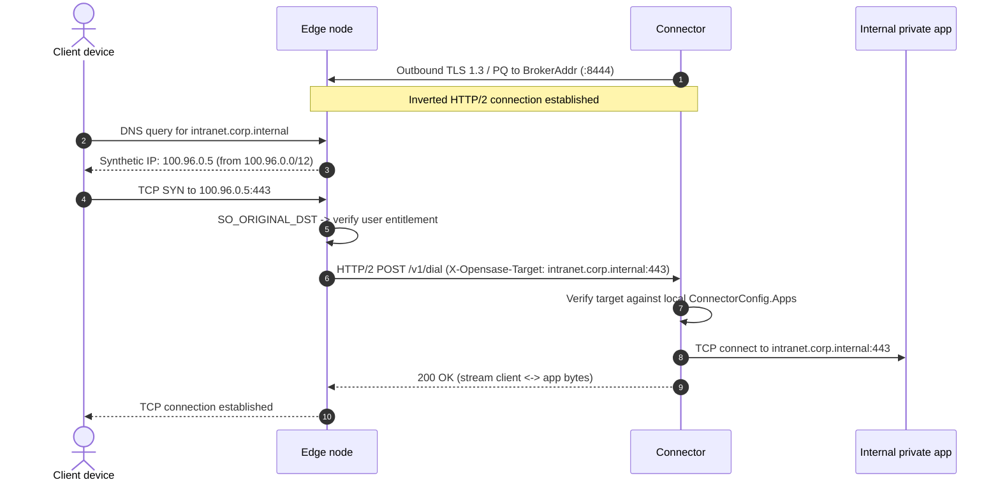

# Private apps and Connectors (ZTNA)

OpenSASE provides Zero Trust Network Access (ZTNA) to private applications through outbound-only
Connectors without exposing inbound firewall ports or granting broad subnet access
([ADR-0013](../adr/0013-ztna-connector.md)).

Applications are published strictly by domain name and port, and access is enforced at both the Edge
and the Connector.



## How private access works

1. **Name-only publishing:** Private apps are addressed by domain name, not IP address. When an
   entitled device queries an app domain, the Edge resolver returns a synthetic IPv4 address from
   `100.96.0.0/12` (`SyntheticPrefix`). This prefix is disjoint from the client tunnel pool
   (`100.64.0.0/16`).
2. **Entitlement in snapshots:** The Control Plane includes an application in a device's Policy
   Snapshot only if the user is listed in `TenantPrivateApp.Users` (or if `Users` is empty, granting
   access to all tenant users). The client firewall allows matching TCP flows at layer `ztna`.
3. **Edge broker redirection:** Edge nodes redirect TCP traffic destined for `100.96.0.0/12` to the
   local broker listener (`:15001`). The broker recovers the original destination domain and client
   identity via `SO_ORIGINAL_DST`, re-verifies access against the device snapshot, and selects an
   online Connector belonging to the app's **Connector group**.
4. **Outbound-only transport:** The Connector initiates and maintains an outbound TLS 1.3 connection
   to each Edge's `BrokerAddr` (`:8444`) using post-quantum hybrid key exchange (`X25519MLKEM768`) and
   mTLS.
5. **Inverted HTTP/2 multiplexing:** Over this connector-initiated connection, roles invert: the Edge
   acts as the HTTP/2 client and the Connector acts as the HTTP/2 server. Each brokered TCP connection
   runs as a multiplexed `POST /v1/dial` stream.
6. **Dual enforcement:** The Connector verifies that the requested `name:port` is listed in its own
   `ConnectorConfig.Apps` before dialing the internal application. Connectors reject loopback and
   link-local destinations by default.

## Managing Connectors

Manage Connectors in the admin portal under **Connectors** (`/connectors`) or using `opensasectl`.

### Create a Connector

1. In the portal, navigate to **Connectors** and click **Create connector**.
2. Enter a **Name** (e.g. `dc-connector-1`) and a **Group** (default `default`).
3. Click **Create** (`POST /v1/admin/tenants/{t}/connectors`).
4. Copy the one-time **provisioning key** (valid for 24 hours, single-use).

To create a connector with the CLI:

```bash
opensasectl connector add -tenant <tenant> -name "dc-connector-1" -group default -key-out /run/secrets/connector.key
```

### Deploy a Connector

Run the `connector` binary on a Linux server or container in the private network hosting your applications:

```bash
connector -control https://<controlplane>:9443#sha256=<root-ca-fingerprint> \
  -key-file /run/secrets/connector.key \
  -state /var/lib/opensase-connector
```

Flags:
- `-control`: Control Plane HTTPS URL. Append `#sha256=<hex>` with the SHA-256 fingerprint of the root CA certificate for initial trust pinning.
- `-key-file`: Path to the file containing the provisioning key (or use environment variable `OPENSASE_CONNECTOR_KEY`).
- `-state`: Directory (mode `0700`) holding the connector private key, certificate, and root CA.
- `-allow-loopback`: Permits resolution to loopback addresses (testing only).
- `-debug`: Enables debug log level.

Once enrolled, the connector obtains a certificate with URI `spiffe://opensase/tenant/<tenant>/connector/<id>`,
valid for 24 hours and automatically renewed at 50% of its lifetime.

### Revoking a Connector

To revoke a connector:
- In the portal, click **Revoke** on the connector row.
- With the CLI:

  ```bash
  opensasectl connector revoke -tenant <tenant> -id <connector-id>
  ```

Edges receive updated peer lists via the Control Plane peer sync (`GET /v1/edge/peers`) and terminate
broker connections from revoked connectors within seconds.

## Configuring Private apps

Configure private applications in the admin portal under **Private apps** (`/private-apps`):

1. Navigate to **Private apps** and click **Add application**.
2. Configure the application definition:
    - **ID:** Unique identifier (e.g. `app-intranet`).
    - **Name:** Display name (e.g. `Corporate Intranet`).
    - **Domains:** Comma-separated domain names (e.g. `intranet.corp.internal`, `*.wiki.corp.internal`).
    - **Ports:** Allowed destination TCP port ranges (e.g. `443`, `80-8080`). UDP is not supported.
    - **Connector group:** The group of connectors capable of reaching this app (e.g. `default`).
    - **Users:** Optional comma-separated list of user IDs or emails entitled to the app. Leave empty
      to grant access to all users in the tenant.
3. Click **Save** in the top action bar to write the policy to `PUT /v1/admin/tenants/{t}/policy`.

With the CLI, private apps can be listed or set in bulk:

```bash
# List private apps
opensasectl app list -tenant <tenant>

# Set private apps from a JSON file ([]api.TenantPrivateApp)
opensasectl app set -tenant <tenant> -file apps.json
```
