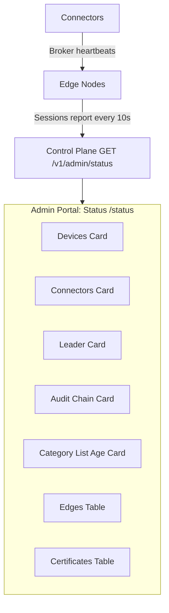

# Deployment status

The **Status** page (`/status`) provides real-time health telemetry across the Control Plane, Edges,
Connectors, and enrolled devices.

Access is restricted to the **super-admin** role. Requests from tenant admin tokens return `403 Forbidden`.
The page automatically refreshes every 30 seconds and can be manually reloaded via the refresh action button.

For metrics scraping endpoints, Prometheus metrics, and alerting rules, see [Monitoring](../operations/monitoring.md).

## Status cards

The top row displays five operational telemetry cards derived from `GET /v1/admin/status`:

### Devices

- **Label:** Devices
- **Value:** `<devicesOnline>` online of `<devicesEnrolled>` enrolled
- **Meaning:** Displays the total count of non-revoked client devices enrolled across all tenants, and the
  subset with an active WireGuard tunnel on any Edge node.

### Connectors

- **Label:** Connectors
- **Value:** `<connectorsOnline>` online of `<connectorsTotal>` total
- **Meaning:** Displays the total count of registered ZTNA Connectors, and the count of Connectors that
  have an active TLS broker connection reported by an Edge within the last 5 minutes.

### Leader

- **Label:** Leader
- **Value:** `Yes` (active leader) or `No` (follower replica)
- **Meaning:** Indicates whether the connected Control Plane replica is the cluster leader running
  singleton background jobs, including blocklist updates, UT1 category list refreshes, audit chain
  verifications, and scheduled database backups ([ADR-0033](../adr/0033-postgresql-and-replicas.md)).

### Audit chain

- **Label:** Audit chain
- **Value:** `OK`, `Broken`, or `Unknown`
- **Meaning:** Reports the integrity of the administrative write audit log secured by a cryptographic
  SHA-256 hash chain ([ADR-0028](../adr/0028-audit-hash-chain.md)):
    - **OK (green):** The hash chain is intact from genesis to the current head record.
    - **Broken (red):** Hash verification failed, indicating unauthorized row modification or deletion.
    - **Unknown (grey):** Chain verification has not run yet.

### Category list age

- **Label:** Category list age
- **Value:** Formatted duration (e.g. `4h 12m`, `1d 8h`), or `Not loaded`
- **Meaning:** Time elapsed since the Control Plane downloaded and parsed the UT1 web category archive
  ([ADR-0022](../adr/0022-web-categories-ut1.md)). If no category list is configured, displays `Not loaded`
  (value `-1`). Under healthy operations, age should remain below 3 days.

## Edges table

The **Edges** section details the state of all registered Edge nodes:

| Column | Description |
|---|---|
| **ID** | Unique identifier of the Edge (e.g. `edge-fra`, `edge-iad`). |
| **Region** | Configured geographic region code (e.g. `eu-west`, `us-east`). Displays `-` if unspecified. |
| **Sessions** | Total active WireGuard client tunnel sessions currently terminated on this Edge. |
| **Reporting** | Status chip indicating whether the Edge reported active sessions within the last 5 minutes (`Yes` in green, `No` in red). |

An Edge marked as not reporting indicates connectivity loss between the Edge and the Control Plane or an
unhealthy Edge process.

## Certificates table

The **Certificates** section monitors certificate lifetimes to prevent service outages:

| Column | Description |
|---|---|
| **Name** | Certificate identity (e.g. Root CA, Control Plane server certificate). |
| **Expires** | Formatted local expiration timestamp (`notAfter`). |
| **Days until expiry** | Remaining validity in days. |

Status chip colors:
- **Green:** Valid with 14 or more days remaining.
- **Amber:** Warning: certificate expires in fewer than 14 days.
- **Red:** Expired.

## Digital experience

The **Experience** page (`/experience`) is available to all tenant roles and provides digital
experience telemetry across enrolled client devices and Edge nodes.

Administrators evaluate connectivity quality over selectable time windows (1 hour, 24 hours,
7 days, or 30 days, defaulting to 24 hours) with automatic background refreshes every 60 seconds:

- **Devices measured:** Total count of unique tenant devices reporting telemetry within the window.
- **Median RTT p50:** Median round-trip latency across all reporting device-Edge pairs.
- **Loss and latency warnings:** Highlights links with packet loss above 2% (warning) or 10% (critical block), and tail latency RTT p95 exceeding 150 ms (warning).

The table resolves device identifiers against enrolled names and offers a real-time device filter.
Telemetry probe collection and query details are described in [Monitoring](../operations/monitoring.md#digital-experience).
