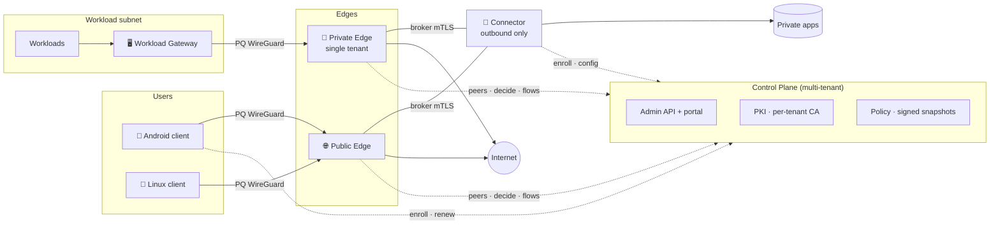

---
hide:
  - navigation
---

# OpenSASE

**Open-source, post-quantum SASE platform: zero-trust access, secure egress and policy in one stack.**

OpenSASE connects users, sites and workloads to the internet and to private apps through Edges
that enforce one policy per tenant. Every tunnel and every API uses post-quantum hybrid key
exchange. There is no classic fallback.

[Get started](getting-started.md){ .md-button .md-button--primary }
[Architecture](architecture.md){ .md-button }
[GitHub](https://github.com/yuky2020/opensase){ .md-button }

!!! warning "Pre-alpha"
    The full path works end to end in the dev stack, and APIs and on-disk formats can still
    change. Do not run it in production yet.

-   :material-shield-key:{ .lg .middle } __Post-quantum by default__

    ---

    TLS 1.3 with `X25519MLKEM768` only, on every listener. WireGuard tunnels get a hybrid PQ
    pre-shared key.

    [:octicons-arrow-right-24: ADR-0002](adr/0002-client-tunnel-wireguard-pq-psk.md)

-   :material-door-closed-lock:{ .lg .middle } __Zero-trust private access__

    ---

    Private apps behind an outbound-only Connector, reached through the Edge broker. Nothing
    is exposed inbound.

    [:octicons-arrow-right-24: ADR-0013](adr/0013-ztna-connector.md)

-   :material-cellphone-lock:{ .lg .middle } __Android client__

    ---

    Flutter UI on a Go core with an on-device firewall, signed policy snapshots and full
    traffic capture.

    [:octicons-arrow-right-24: ADR-0012](adr/0012-android-client-first.md)

-   :material-office-building-cog:{ .lg .middle } __Private Edge__

    ---

    The same Edge on premises, bound to one tenant, starting offline from a signed cache.

    [:octicons-arrow-right-24: ADR-0014](adr/0014-private-edge.md)

-   :material-server-network:{ .lg .middle } __Workload Gateway__

    ---

    Whole subnets behind the PQ tunnel, with DNS diverted to the Edge and a fail-closed kill
    switch.

    [:octicons-arrow-right-24: ADR-0015](adr/0015-workload-gateway-mvp.md)

-   :material-web-check:{ .lg .middle } __Web and SaaS control__

    ---

    Hostname from TLS SNI or HTTP Host, enforced without decryption; SaaS catalog with
    one-click blocking and discovery.

    [:octicons-arrow-right-24: ADR-0017](adr/0017-web-saas-control-sni.md)

-   :material-magnify-scan:{ .lg .middle } __Opt-in TLS inspection__

    ---

    Per-tenant inspection root, URL path and method rules, request header injection, bypass
    list; fail closed.

    [:octicons-arrow-right-24: ADR-0018](adr/0018-tls-inspection.md)

-   :material-shield-lock-outline:{ .lg .middle } __DLP on uploads__

    ---

    Checksum-validated card, IBAN and tax-code detectors, private keys and custom patterns on
    inspected uploads; counts only, never the data.

    [:octicons-arrow-right-24: ADR-0019](adr/0019-dlp-request-bodies.md)

-   :material-shape-outline:{ .lg .middle } __Web categories__

    ---

    The public UT1 category list, refreshed by the Control Plane, enforced by Edges on DNS and
    SNI.

    [:octicons-arrow-right-24: ADR-0022](adr/0022-web-categories-ut1.md)

-   :material-virus-off-outline:{ .lg .middle } __Malware scanning__

    ---

    Uploads and file downloads scanned by ClamAV next to the Edge; fail open or closed per
    tenant.

    [:octicons-arrow-right-24: ADR-0020](adr/0020-malware-scanning.md)

-   :material-account-key:{ .lg .middle } __Multi-tenant, audited__

    ---

    Per-tenant CA, a super-admin plus tenant-scoped admin tokens, and an audit log of every
    admin write.

    [:octicons-arrow-right-24: ADR-0016](adr/0016-tenant-admin-tokens.md)

## Architecture

| Component | What it does | Code |
|---|---|---|
| **Control Plane** | Tenants, users, devices, PKI, policy, decisions, flow logs, admin API and portal | `cmd/controlplane`, `internal/controlplane` |
| **Edge** | PQ WireGuard termination, policy enforcement, DNS filter, NAT breakout, ZTNA broker. Public or private | `cmd/edge`, `internal/edge` |
| **Connector** | Outbound-only link from a private network to the Edge broker | `cmd/connector`, `internal/connector` |
| **Linux client / Workload Gateway** | Headless client; `-gateway CIDRS` forwards whole subnets | `cmd/opensase-client` |
| **Android client** | Flutter app plus Go core (`gomobile`) | `clients/mobile`, `mobile/` |
| **Admin portal** | Flutter web, served by the Control Plane at `/admin/` | `clients/admin` |
| **CLI** | Admin and diagnostics (`opensasectl`, including `pq-check`) | `cmd/opensasectl` |

## What works today

| Area | State |
|---|---|
| PQ tunnel (WireGuard + hybrid PSK) | ✅ |
| Enrollment, 24h certificate renewal, revocation, certificate serial pinning | ✅ |
| Signed policy snapshots, on-device firewall, Edge decisions (`allow` / `deny` / `ask`) | ✅ |
| DNS policy (third-party DNS, DoT and DoH bypass blocked), IPv6 leak protection | ✅ |
| ZTNA through the Connector | ✅ |
| Private Edge: tenant binding, signed offline cache, local flow log | ✅ |
| Workload Gateway (routed subnet, NAT, DNS divert, MSS clamp, kill switch) | ✅ |
| Admin portal (tenants, users, policy, private apps, SaaS apps, web categories, web inspection, infrastructure, admin tokens, audit, activity, security events) | ✅ |
| Tenant-scoped admin tokens: super-admin plus per-tenant admins ([ADR-0016](adr/0016-tenant-admin-tokens.md)) | ✅ |
| Admin audit log: every admin write, with its actor and result, hash-chained and verifiable ([ADR-0028](adr/0028-audit-hash-chain.md)) | ✅ |
| Pinned control URL for enrollment QR codes (`GET /v1/admin/info`), policy ETags against lost updates | ✅ |
| Web and SaaS control without decryption: TLS SNI / HTTP Host enforcement, SaaS catalog, app discovery ([ADR-0017](adr/0017-web-saas-control-sni.md)) | ✅ |
| Opt-in TLS inspection: URL rules (path, method), request header injection, bypass list, HTTP/2 ([ADR-0018](adr/0018-tls-inspection.md), [ADR-0023](adr/0023-http2-inspected-path.md)) | ✅ |
| DLP on uploads: card numbers, IBANs, tax codes, private keys, custom patterns ([ADR-0019](adr/0019-dlp-request-bodies.md)) | ✅ |
| Malware scanning of uploads and file downloads with ClamAV ([ADR-0020](adr/0020-malware-scanning.md)) | ✅ |
| DLP inside Office, PDF and ZIP files, and on file downloads ([ADR-0021](adr/0021-dlp-documents-downloads.md)) | ✅ |
| Web categories from the public UT1 list, enforced on DNS and SNI ([ADR-0022](adr/0022-web-categories-ut1.md)) | ✅ |
| DLP on legacy Office (.doc/.xls/.ppt), RTF and images with OCR ([ADR-0024](adr/0024-dlp-legacy-office-ocr.md)) | ✅ |
| SafeSearch for Google, YouTube, Bing and DuckDuckGo, with bypass protection ([ADR-0025](adr/0025-safesearch.md)) | ✅ |
| DLP on scanned PDFs (OCR) and PDFs with CID fonts ([ADR-0026](adr/0026-pdf-structure-cid-images.md)); brotli and zstd bodies | ✅ |
| Roles inside a tenant: admin, policy-editor, viewer ([ADR-0027](adr/0027-tenant-roles.md)) | ✅ |
| DLP exact data match and document fingerprints ([ADR-0029](adr/0029-dlp-exact-data-match.md)) | ✅ |
| OIDC for the portal, ICAP engines, cloud GENEVE ingress for the gateway | 🗺️ planned |

## Roadmap

1. **SWG and CASB, next slice:** opt-in TLS interception with tenant CAs (URL paths, tenant restrictions), then DLP.
2. Roles inside a tenant, OIDC sign-in for the portal, and audit shipping to an append-only store.
3. Control Plane `GET /v1/admin/info` (pinned control URL for the portal's enrollment QR) and policy ETags.
4. Policy language decision ([ADR-0005](adr/README.md), proposed).
5. Workload Gateway for the cloud: GENEVE ingress, metadata-based identity, per-workload flows.

## Licence

Copyright 2026 The OpenSASE Authors. Licensed under the
[Apache License, Version 2.0](https://github.com/yuky2020/opensase/blob/main/LICENSE). No CLA is
required: contributions are accepted under the same licence.
