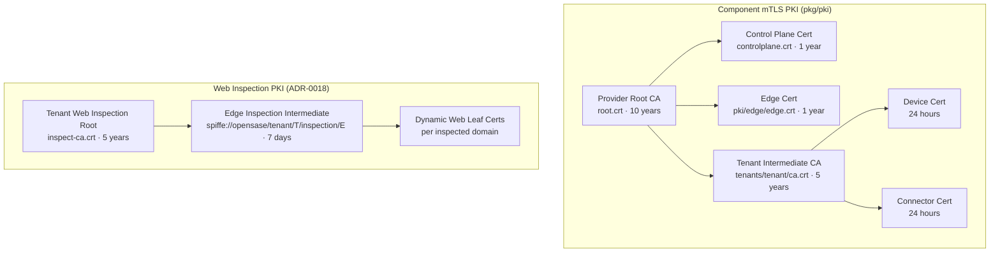
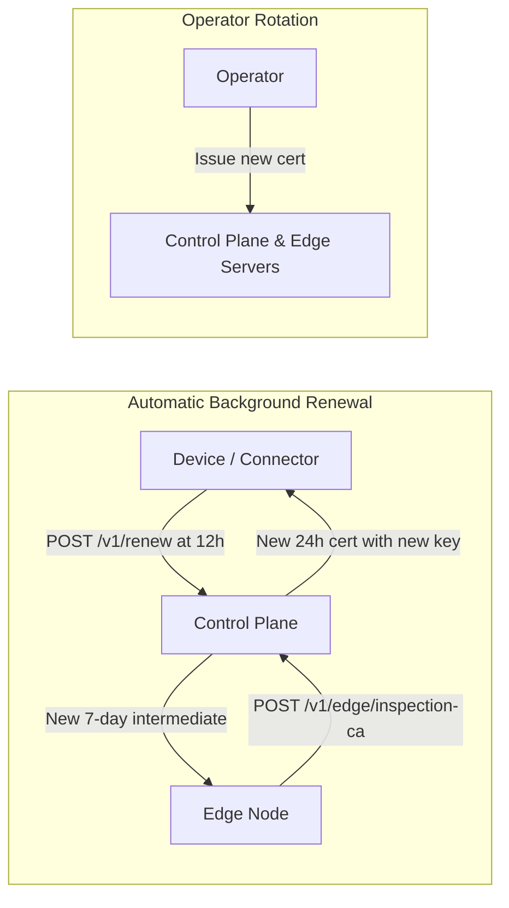

# Certificates and PKI

OpenSASE uses a public key infrastructure (PKI) based on ECDSA P-256 for component identities and
mTLS communication (`pkg/pki`). All certificates use SPIFFE URI Subject Alternative Names (SANs)
under the trust domain `opensase`.

## Certificate architecture

OpenSASE separates central mTLS authentication from TLS web inspection ([ADR-0018](../adr/0018-tls-inspection.md)).
The mTLS PKI cannot mint web certificates, and tenant web inspection roots cannot authenticate
platform components.

---

## Certificate inventory

| Certificate | Subject / Identity | Extended Key Usage | Default Lifetime | Storage Location |
|---|---|---|---|---|
| **Provider Root CA** | `CN=<name>, O=OpenSASE` | `CertSign`, `CRLSign` | 10 years (`RootValidity`) | `pki/root.crt`, `pki/root.key` |
| **Control Plane** | `CN=OpenSASE Control Plane, O=OpenSASE` `spiffe://opensase/controlplane` | `ServerAuth` | 1 year (`ServerValidity`) | `pki/controlplane.crt`, `pki/controlplane.key` |
| **Edge** | `CN=OpenSASE Edge <id>, O=OpenSASE` `spiffe://opensase/edge/<id>` | `ServerAuth`, `ClientAuth` | 1 year (`ServerValidity`) | `pki/edge/edge.crt`, `pki/edge/edge.key` |
| **Tenant CA** | `CN=OpenSASE tenant <tenant>, O=OpenSASE, OU=<tenant>` `spiffe://opensase/tenant/<tenant>` | `CertSign`, `CRLSign` (`MaxPathLen: 0`) | 5 years (`IntermediateValidity`) | `pki/tenants/<tenant>/ca.crt`, `ca.key` or database `cas` table |
| **Device** | `CN=<device-name>, OU=<tenant>` `spiffe://opensase/tenant/<tenant>/device/<id>` | `ClientAuth` | 24 hours (`DeviceValidity`) | Client local state directory |
| **Connector** | `CN=connector-<id>, OU=<tenant>` `spiffe://opensase/tenant/<tenant>/connector/<id>` | `ClientAuth` | 24 hours (`DeviceValidity`) | Connector local state directory |
| **Tenant Web Inspection Root** | `CN=OpenSASE web inspection <tenant>, O=OpenSASE, OU=<tenant>` | `ServerAuth` (`MaxPathLen: 1`) | 5 years (`InspectionRootValidity`) | `pki/tenants/<tenant>/inspect-ca.crt` or database `cas` table |
| **Edge Web Inspection Intermediate** | `CN=OpenSASE web inspection <tenant> (edge <edge-id>)` `spiffe://opensase/tenant/<tenant>/inspection/<edge-id>` | `ServerAuth` (`MaxPathLen: 0`) | 7 days (`InspectionIntermediateValidity`) | Edge memory / `StateDir` |

---

## Detailed certificate descriptions

### Provider Root CA

The root CA is a self-signed certificate created during initial setup (`opensasectl pki init`).
It anchors trust for all Control Plane, Edge, and tenant intermediate certificates.

- The Control Plane requires `root.crt` and `root.key` to sign server and tenant certificates.
- The Edge receives only `pki/edge/root.crt` to verify incoming device certificates and validate
  the Control Plane identity. The Edge must **never** receive `root.key`.

### Control Plane certificate

The Control Plane uses this certificate for its HTTPS API and admin portal listener (`-listen :9443`).

- Subject Alternative Names include `spiffe://opensase/controlplane` and host DNS/IP addresses
  specified with `-cp-san`.
- Clients verify the SPIFFE URI (`spiffe://opensase/controlplane`) rather than relying solely on DNS names.

### Edge certificate

The Edge server certificate terminates client HTTPS session setups (`-listen :8443`) and ZTNA
broker listener connections (`-broker-listen :8444`).

- Subject Alternative Names include `spiffe://opensase/edge/<id>` and host DNS/IP addresses
  specified with `-edge-san`.
- Extended Key Usage includes both `ServerAuth` (for incoming client and connector sessions) and
  `ClientAuth` (to authenticate to the Control Plane when fetching peers and uploading flow logs).
- Edges must be registered in the Control Plane (`opensasectl edge add -id <id>`). Unregistered
  or revoked Edges receive HTTP `403 Forbidden`.

### Tenant intermediate CAs

Each tenant receives an intermediate CA signed by the provider root CA. Tenant CAs sign device
and Connector client certificates.

- Setting `MaxPathLen: 0` prevents tenant CAs from creating subordinate CAs.
- In multi-replica Control Plane deployments ([ADR-0033](../adr/0033-postgresql-and-replicas.md)),
  tenant CA private keys are sealed with AES-256-GCM using `ca-kek.key` and stored in the database
  `cas` table. Every Control Plane replica loads the shared CAs, ensuring consistent issuance across replicas.
- Replicas refresh tenant CAs from the database every 30 seconds (`caRefreshInterval`).

### Device certificates

Client devices receive a short-lived (24-hour) certificate during enrollment (`POST /v1/enroll`):

- Devices generate an ECDSA P-256 private key and submit a CSR to the Control Plane.
- The certificate encodes the tenant and device identity: `spiffe://opensase/tenant/<tenant>/device/<id>`.
- Device certificates have `ClientAuth` extended key usage.

### Connector certificates

ZTNA Connectors receive short-lived (24-hour) certificates during enrollment (`POST /v1/connector/enroll`):

- The certificate encodes the Connector identity: `spiffe://opensase/tenant/<tenant>/connector/<id>`.
- Used to establish mutual TLS with Edge broker listeners on port `8444` (`ALPN opensase-broker/1`).

### Web inspection CAs

When TLS inspection is enabled ([ADR-0018](../adr/0018-tls-inspection.md)):

- **Tenant inspection root:** A self-signed CA generated per tenant (`CN=OpenSASE web inspection <tenant>`).
  Users download this root certificate from the admin portal or `opensasectl inspection-ca -tenant <tenant>`
  and install it in operating system or browser trust stores. It has `ServerAuth` extended key usage and
  cannot be used for mTLS client authentication.
- **Edge inspection intermediate:** Each Edge generates its own key pair and requests an inspection
  intermediate from the Control Plane (`POST /v1/edge/inspection-ca`). Intermediates are valid for
  7 days. This short lifetime limits exposure if an Edge host is compromised.

---

## Renewal and rotation

### Device and Connector certificate renewal

Devices and Connectors renew certificates automatically in the background:

1. Certificates have a 24-hour validity (`DeviceValidity`).
2. Clients initiate renewal at approximately 50% of the lifetime (12 hours) by generating a new
   ECDSA P-256 key pair and submitting a CSR via `POST /v1/renew` (devices) or `POST /v1/connector/renew`
   (Connectors).
3. **Lost response recovery:** The database records `cert_serial` and `prev_cert_serial`. If a client
   sends a renewal request but disconnects before receiving the response, it is permitted to retry
   `POST /v1/renew` using the previous certificate serial.
4. Once the new certificate serial successfully authenticates a request, `ForgetPrevDeviceSerial`
   clears `prev_cert_serial`, preventing older certificates from being reused.

### WireGuard hybrid PSK rotation

WireGuard tunnels do not rely on long-lived pre-shared keys:

- The Edge and client derive a post-quantum pre-shared key (PSK) during session setup (`POST /v1/session`)
  using TLS 1.3 key exporter (`X25519MLKEM768`, [ADR-0002](../adr/0002-client-tunnel-wireguard-pq-psk.md)).
- Sessions rotate periodically based on the `-rotate` flag (default: 10 minutes).
- Clients call `POST /v1/session` with incrementing epoch counters (`epoch = current + 1`).
- The Edge keeps superseded sessions active for a grace period (`supersededGrace = rotate + 1m`) to
  prevent packet drop during rotation.

### Server certificate rotation

Control Plane and Edge server certificates have a 1-year lifetime (`ServerValidity`).

1. Monitor certificate expiry through Prometheus metrics (see [Monitoring](monitoring.md)):
    - `opensase_cp_certificate_expiry_seconds{cert="controlplane"}`
    - `opensase_cp_certificate_expiry_seconds{cert="root"}`
    - `opensase_edge_certificate_expiry_seconds`
2. Prometheus alert rules warn when any certificate expires in under 14 days.
3. To renew server certificates, issue a new certificate using the root CA and restart the server
   process with the updated certificate and key files.
