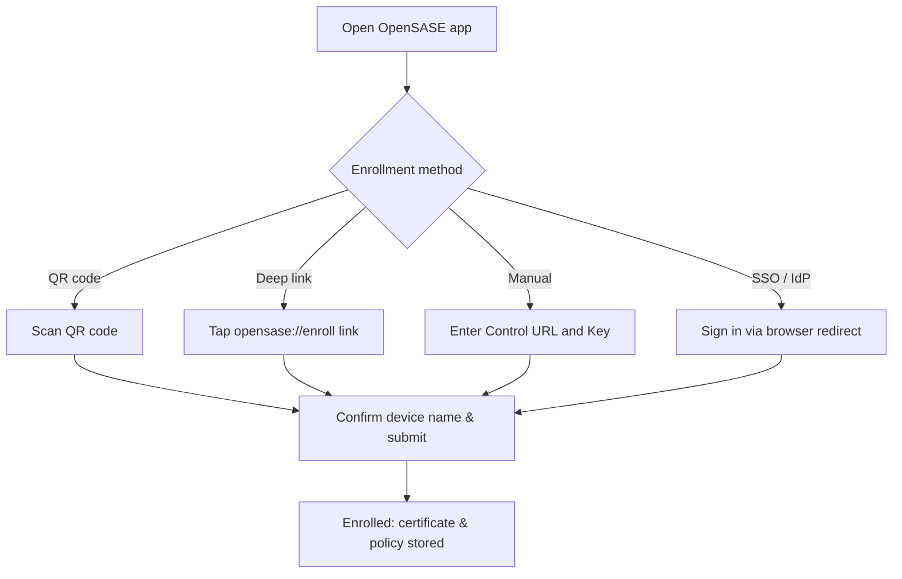

# Android client

The OpenSASE Android application combines a Flutter interface with an embedded Go engine
(`mobile` package, [ADR-0012](../adr/0012-android-client-first.md), [Client architecture](../mobile-client.md)).
It runs on Android 10 or later (API level ≥ 29).

## Install

To install the client:

1. Download the APK package (`app-debug.apk` or release build) from your organization's distribution portal
   or repository release page ([Download](../download.md)).
2. If installing via Android Debug Bridge (`adb`):

    ```bash
    adb install app-debug.apk
    ```

3. Launch the **OpenSASE** app from your application drawer.

## Enrol

When launched for the first time, the application displays the **Welcome** enrollment screen.



### Option 1: Scan an enrollment QR code

1. Obtain an enrollment QR code from the admin portal (**Users** or **Get started** wizard).
2. Tap the **QR scanner** icon in the **Enrollment code** field.
3. Point your camera at the QR code. The app automatically extracts the Control Plane URL,
   root certificate pin (`#sha256=...`), and the single-use provisioning key.
4. Verify the **Device name** and tap **Enroll device**.

### Option 2: Tap an enrollment deep link

If you received an enrollment invitation email or message containing an `opensase://enroll` link:

1. Tap the link on your Android device.
2. The OpenSASE app opens with the Control Plane URL and provisioning key pre-filled.
3. Tap **Enroll device**.

### Option 3: Single Sign-On (SSO) with your Identity Provider

If your organisation uses an external identity provider ([ADR-0031](../adr/0031-portal-oidc-sign-in.md), [Users and provisioning](../operations/identity.md)):

1. Open the enrollment URL provided by your administrator in your mobile browser:
   `https://<controlplane>:9443/v1/enroll/oidc/<tenant>/start?return_to=opensase://enroll`
2. Authenticate with your corporate credentials.
3. Upon successful sign-in, the browser redirects to the OpenSASE app with a single-use provisioning key
   valid for 5 minutes.
4. Confirm your device name and tap **Enroll device**.

### Option 4: Manual configuration

1. Enter the **Control URL**, including the certificate hash fragment:
   `https://controlplane.example.com:9443#sha256=<hex-fingerprint>`
2. Enter the **Provisioning key**.
3. Enter a friendly **Device name**.
4. Tap **Enroll device**.

Upon enrollment, the client generates a local private key, issues a CSR, receives a device certificate,
and downloads the tenant's Policy Snapshot.

## Connect and disconnect

1. On the **Home** tab, toggle the main connection switch.
2. If connecting for the first time, Android displays the standard system connection request dialog:
   *"OpenSASE wants to set up a VPN connection that allows it to monitor network traffic."*
   Tap **OK**.
3. The engine negotiates a WireGuard session with the nearest Edge using post-quantum hybrid key exchange
   (`X25519MLKEM768`, [ADR-0002](../adr/0002-client-tunnel-wireguard-pq-psk.md)).
4. When connected, the status displays **Connected** with a green shield, and a key icon appears in the
   Android status bar.
5. To disconnect, toggle the connection switch off.

## Status and monitoring

The application provides real-time status and activity details across several tabs:

- **Home screen:**
    - Connection state (`Connected`, `Connecting`, `Stopped`, or `Error`).
    - Assigned tunnel IP address (e.g. `100.64.0.15`).
    - Connected Edge ID and geographic region.
    - Post-quantum security indicator (`PQ: X25519MLKEM768`).
    - Active Policy Snapshot version and status (shows `(stale)` if the snapshot has expired).
- **Activity tab:** Live stream of network flows showing timestamps, destinations, protocols, and verdicts
  (`allow`, `block`, or `ask`).
- **Settings tab:**
    - Certificate expiration timestamp and device ID.
    - Policy fallback action and lockdown status.
    - **Export flow logs:** Saves recent flow records to a JSON file.
    - **Always-on VPN:** Tap **Open VPN Settings** to configure Android's native *Always-on VPN* and
      *Block connections without VPN* settings.
    - **Connect on boot:** Automatically connect when the device powers on.

## Unenroll and uninstall

### Unenroll

To remove device credentials and policy from the device:

1. Open the **Settings** tab.
2. Tap **Unenroll device** (highlighted in red).
3. Confirm the unenrollment dialog.
4. The client disconnects the tunnel, wipes local cryptographic keys, certificates, and stored snapshots,
   and returns to the initial Welcome screen.

### Uninstall

To completely remove the app, long-press the OpenSASE icon on your home screen or app drawer, tap
**App info**, and select **Uninstall** (or drag to the Uninstall trash can).
