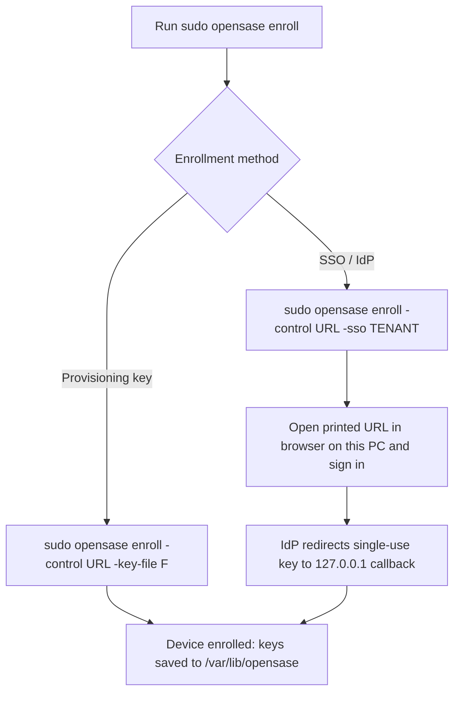

# Linux client

The OpenSASE Linux desktop client consists of a background system daemon (`opensased`) and a CLI
control tool (`opensase`) ([ADR-0032](../adr/0032-windows-client.md)). It communicates over a secure
local Unix domain socket (`/run/opensase/opensased.sock`).

## Prerequisites

- Linux kernel with `/dev/net/tun` support.
- `systemd-resolved` (recommended for automatic DNS integration via `resolvectl`).
- `nftables` (`nft` binary, required for the fail-closed desktop kill switch).
- Root privileges to install the daemon service and perform initial device enrollment.

## Install

### 1. Install binaries

Place `opensased` and `opensase` into your system path (for example `/usr/local/bin/`):

```bash
sudo install -m 0755 opensased /usr/local/bin/opensased
sudo install -m 0755 opensase /usr/local/bin/opensase
```

### 2. Configure user group

`opensased` grants non-root access to users belonging to the `opensase` system group:

```bash
# Create the opensase group if it does not exist
sudo groupadd -f opensase

# Add your current desktop user to the group
sudo usermod -aG opensase $USER
```

Log out and back in for the group membership to take effect.

### 3. Create the systemd service

Create the service unit file at `/etc/systemd/system/opensased.service`:

```ini
[Unit]
Description=OpenSASE desktop daemon
After=network.target

[Service]
Type=simple
ExecStart=/usr/local/bin/opensased -state /var/lib/opensase -socket /run/opensase/opensased.sock -group opensase
Restart=always
RestartSec=5s
KillMode=process

# Sandboxing and capabilities
CapabilityBoundingSet=CAP_NET_ADMIN CAP_NET_RAW CAP_SETUID CAP_SETGID
AmbientCapabilities=CAP_NET_ADMIN CAP_NET_RAW

[Install]
WantedBy=multi-user.target
```

Enable and start the service:

```bash
sudo systemctl daemon-reload
sudo systemctl enable --now opensased
```

Verify that the daemon socket was created:

```bash
ls -l /run/opensase/opensased.sock
# srw-rw---- 1 root opensase 0 ... /run/opensase/opensased.sock
```

## Enrol

Enrolling registers the device and saves cryptographic certificates in `/var/lib/opensase`.
Because enrollment writes machine credentials, it requires **root elevation** (`sudo`).



### Option 1: Enrol with a provisioning key

Obtain a device provisioning key from your administrator or the admin portal:

```bash
# Pass key from a file (mode 0600)
sudo opensase enroll -control "https://controlplane.example.com:9443#sha256=<root-pin>" -key-file /path/to/key.txt

# Or enter key via interactive terminal prompt
sudo opensase enroll -control "https://controlplane.example.com:9443#sha256=<root-pin>"
```

### Option 2: Enrol with Single Sign-On (SSO)

If your organisation uses an external identity provider ([Users and provisioning](../operations/identity.md)):

```bash
sudo opensase enroll -control "https://controlplane.example.com:9443#sha256=<root-pin>" -sso <tenant-id>
```

1. The CLI starts a local loopback HTTP listener and prints a sign-in URL:

    ```text
    Open this URL in a browser on this computer and sign in:

      https://controlplane.example.com:9443/v1/enroll/oidc/<tenant>/start?return_to=http://127.0.0.1:41235/callback&state=...

    Waiting for the sign-in (5 minutes)...
    ```

2. Open the URL in your browser and complete the authentication flow.
3. The identity provider redirects back to the loopback server with a single-use key valid for 5 minutes.
4. The CLI completes enrollment automatically and prints:

    ```text
    Device enrolled successfully.
    ```

## Connect and disconnect

Once enrolled, any user in the `opensase` group can connect or disconnect the tunnel without `sudo`:

```bash
# Connect the VPN tunnel
opensase connect

# Disconnect the VPN tunnel
opensase disconnect
```

During connection:
1. `opensased` creates the TUN device `osase0`.
2. It assigns tunnel IPv4 (/32) and IPv6 (/128) addresses and configures MTU 1280.
3. It installs split default routes (`0.0.0.0/1` and `128.0.0.0/1`, `::/1` and `8000::/1`) via `osase0`.
4. It installs `/32` bypass host routes via your physical default gateway so WireGuard UDP traffic
   and Control Plane HTTPS connections reach their targets directly.
5. If `resolvectl` is present, it configures systemd-resolved:
   `resolvectl dns osase0 100.64.0.1` and `resolvectl domain osase0 ~.`, routing all DNS to the Edge resolver.

## Status and telemetry

Check current tunnel status:

```bash
opensase status
```

Example output:
```text
State: connected  Enrolled: yes  Edge: edge-fra  PQ: X25519MLKEM768  Policy: v3
```

To output structured JSON:

```bash
opensase -json status
```

View recent traffic flows and policy decisions:

```bash
opensase flows -n 25
```

Stream live engine events:

```bash
opensase events -f
```

## Kill switch

Linux clients enforce a **fail-closed kill switch** using `nftables` (issue #79):

- While the tunnel is connected, `opensased` installs an atomic nftables table (`table inet opensase_killswitch`):
    - Drops all outbound traffic leaving outside the tunnel interface (`osase0`).
    - Permits loopback (`lo`).
    - Permits outbound traffic to the resolved Control Plane and Edge bypass host addresses.
    - Permits DHCP client requests (`udp sport 68 udp dport 67` and `udp sport 546 udp dport 547`).
    - Permits IPv6 neighbour discovery (`nd-router-solicit`, `nd-neighbor-solicit`, `nd-neighbor-advert`).
- On disconnect (`opensase disconnect`), the nftables table is removed, restoring standard network routing.
- If the daemon crashes unexpectedly, the table remains active to prevent data leakage outside the tunnel.
  Normal traffic can be restored by restarting the service or manually deleting the table:

  ```bash
  sudo nft delete table inet opensase_killswitch
  ```

- To disable the kill switch across your fleet, configure `disableKillSwitch: true` in the tenant policy.

## Unenroll and uninstall

### Unenroll

To wipe local credentials and certificates (requires `sudo`):

```bash
sudo opensase unenroll -yes
```

### Uninstall

To completely remove the client and daemon:

```bash
# 1. Stop and disable the systemd service
sudo systemctl disable --now opensased

# 2. Remove the service file and reload systemd
sudo rm -f /etc/systemd/system/opensased.service
sudo systemctl daemon-reload

# 3. Remove application binaries and state directories
sudo rm -f /usr/local/bin/opensased /usr/local/bin/opensase
sudo rm -rf /var/lib/opensase /run/opensase
```
