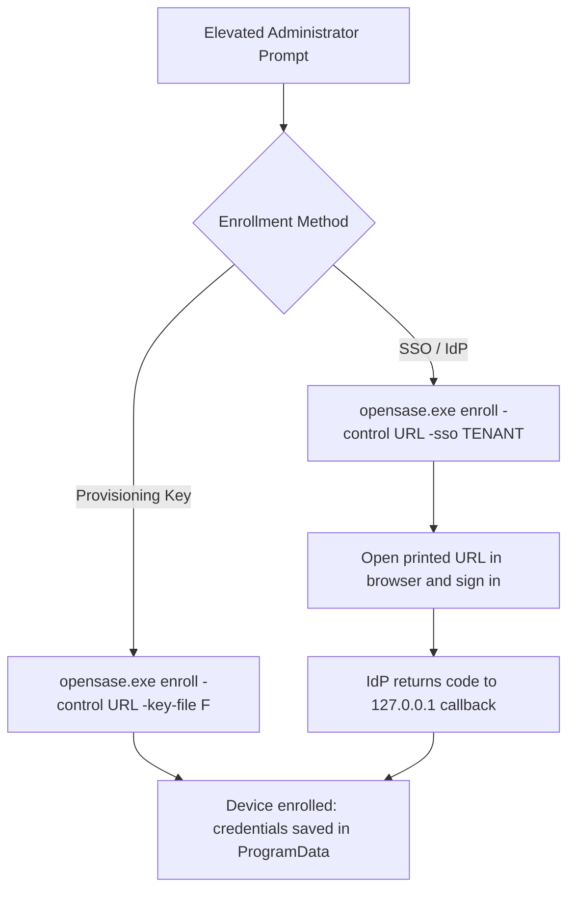

# Windows client

The OpenSASE Windows client operates as a background Windows Service (`opensased.exe`) managed through
a local command-line interface (`opensase.exe`) or desktop application ([ADR-0032](../adr/0032-windows-client.md)).
It requires 64-bit Windows 10, Windows 11, or Windows Server 2022+.

## Prerequisites and driver

OpenSASE creates a virtual network interface using the Wintun driver:

1. Download `opensased.exe` and `opensase.exe` from the releases page ([Download](../download.md)).
2. Download the signed `wintun.dll` driver from the official Wintun distribution.
3. Place `wintun.dll` in the **same directory** as the executables (for example `C:\Program Files\OpenSASE\`).
   `opensased.exe` verifies that `wintun.dll` is present next to its binary before initializing.

## Install the service

The background daemon must be installed and registered as a Windows Service. Run an administrative
Command Prompt or PowerShell:

```powershell
# 1. Create installation directory and copy binaries
mkdir "C:\Program Files\OpenSASE"
copy opensased.exe "C:\Program Files\OpenSASE\"
copy opensase.exe "C:\Program Files\OpenSASE\"
copy wintun.dll "C:\Program Files\OpenSASE\"
cd "C:\Program Files\OpenSASE"

# 2. Register the service with the Service Control Manager
.\opensased.exe install

# 3. Start the service
net start OpenSASE
```

The service registers as `OpenSASE` (Display Name: "OpenSASE client") configured to start automatically
on boot (`StartAutomatic`). State, keys, and certificates are stored in `%ProgramData%\OpenSASE`,
protected with Windows ACLs granting access exclusively to `SYSTEM` and `Administrators`.

The service listens on the local named pipe `\\.\pipe\opensase` with a security descriptor permitting
local interactive users to view status and control tunnels.

## Enrol

Device enrollment creates local cryptographic keys, generates a CSR, and registers the device with
the Control Plane. Enrollment modifies device identity and requires an **elevated administrator prompt**.



### Option 1: Enrol with a provisioning key

Obtain a provisioning key from your administrator or the admin portal:

```powershell
# Using a key file
.\opensase.exe enroll -control "https://controlplane.example.com:9443#sha256=<root-pin>" -key-file "C:\path\to\key.txt"

# Or enter key via interactive hidden prompt
.\opensase.exe enroll -control "https://controlplane.example.com:9443#sha256=<root-pin>"
```

### Option 2: Enrol with Single Sign-On (SSO)

If your organisation has configured an identity provider ([Users and provisioning](../operations/identity.md)):

```powershell
.\opensase.exe enroll -control "https://controlplane.example.com:9443#sha256=<root-pin>" -sso <tenant-id>
```

1. The CLI starts a local loopback server and outputs a sign-in link:

    ```text
    Open this URL in a browser on this computer and sign in:

      https://controlplane.example.com:9443/v1/enroll/oidc/<tenant>/start?return_to=http://127.0.0.1:54321/callback&state=...

    Waiting for the sign-in (5 minutes)...
    ```

2. Open the URL in your browser and complete authentication.
3. The identity provider redirects back to the local loopback server with a single-use provisioning key.
4. The CLI completes enrollment automatically and prints:

    ```text
    Device enrolled successfully.
    ```

## Connect and disconnect

Once enrolled, any standard (non-elevated) interactive user can connect or disconnect the tunnel:

```powershell
# Connect the VPN tunnel
opensase connect

# Disconnect the VPN tunnel
opensase disconnect
```

When connecting:
1. The daemon creates the Wintun adapter `OpenSASE`.
2. It assigns tunnel IPv4 (/32) and IPv6 (/128) addresses and sets adapter DNS to `100.64.0.1`.
3. It installs split default routes (`0.0.0.0/1` and `128.0.0.0/1`) to route internet traffic through
   the tunnel without deleting the physical gateway.
4. It installs `/32` bypass host routes on the physical network interface so WireGuard and Control Plane
   traffic reach their destinations directly.

## Status and telemetry

Check the current tunnel and engine state:

```powershell
# Text status line
opensase status
```

Example output:
```text
State: connected  Enrolled: yes  Edge: edge-fra  PQ: X25519MLKEM768  Policy: v4
```

To output raw JSON for monitoring or automation:

```powershell
opensase -json status
```

Inspect recent traffic flows evaluated by the policy engine:

```powershell
opensase flows -n 20
```

Follow the real-time event stream from the engine:

```powershell
opensase events -f
```

## Kill switch

By default, the Windows client operates with a **fail-closed kill switch** ([ADR-0032](../adr/0032-windows-client.md)):

- While connected, split default routes route all traffic into the Wintun adapter.
- Only the specific `/32` host routes for the Control Plane and Edge endpoints remain routable over
  the physical adapter.
- If the tunnel drops or connection to the Edge is lost, traffic outside the tunnel is stopped.
- On graceful disconnection (`opensase disconnect` or service shutdown), the daemon flushes the Wintun
  routes and removes the bypass host routes from the physical interface, restoring standard connectivity.
- The kill switch can be disabled by tenant policy using `disableKillSwitch: true`.

## Unenroll and uninstall

### Unenroll the device

To remove local certificates, private keys, and cached snapshots (requires administrator elevation):

```powershell
opensase unenroll -yes
```

### Remove the service

To uninstall the background service:

```powershell
# Stop and remove the service
cd "C:\Program Files\OpenSASE"
.\opensased.exe uninstall

# Remove application files
cd ..
Remove-Item -Recurse -Force "C:\Program Files\OpenSASE"
Remove-Item -Recurse -Force "C:\ProgramData\OpenSASE"
```
